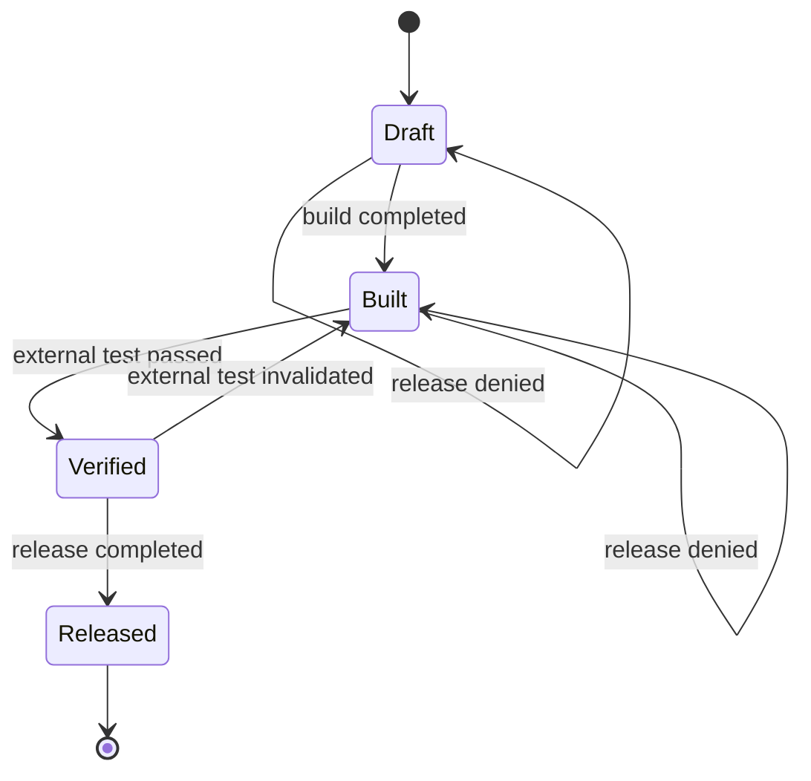

# Supervisory control

**Give agents room to act, with a shared program deciding what is admissible now.**

A real Codex CLI delegates a delivery task to a real Qwen or DeepSeek CLI.
Both agents cross Pitot's action boundary. One Python application owns the
supervisor, delivery state and external tester. A loopback LLM replay server
supplies the agents' responses, so no model account or real model call is needed.

```text
Codex <-> Pitot <-> Python supervisor <-> Pitot <-> Qwen or DeepSeek
                         |
                  artifact + tester
```

## The control idea, in plain English

A permission such as “this agent may publish” is often too broad. The useful
question is whether this particular artifact may be published in the current
state. A new edit or failed test can change the answer without changing the agent.

In classical Ramadge–Wonham supervisory control, a supervisor observes system
events and disables controllable actions that would violate a specification.
Uncontrollable events can still occur; the supervisor must respond to their
effects. See [Wonham, Cai and Rudie's introduction and history](https://www.control.utoronto.ca/~wonham/Wonham_SCDES_history.pdf).

| Concept              | Plain meaning                                   | In this example                                   |
| -------------------- | ----------------------------------------------- | ------------------------------------------------- |
| Plant                | The system whose behavior is being controlled   | The artifact and delivery process                 |
| State                | Facts that determine what can happen next       | Delivery stage, artifact revision and test result |
| Controllable action  | An action the supervisor can prevent            | A worker's build or release                       |
| Uncontrollable event | An event outside the agent's permission to stop | The tester invalidating a result                  |
| Specification        | The behavior that must remain acceptable        | Release only the current tested artifact          |
| Feedback             | Observations that change the next decision      | Completed work, test results and denial messages  |

Good supervision also leaves a path to the objective. Denying every action would
prevent a bad release, but would also prevent useful work. Here a denied worker
can build, obtain a current test result and try again. This illustrates the
nonblocking idea of keeping completion reachable; it does not promise that an
arbitrary agent or external tester will eventually succeed.

## System and specification

The toy delivery plant has four states: `draft`, `built`, `verified`, `released`.
`released` is its legitimate objective. The controllable actions are delegation,
build and release. The application tester produces uncontrollable test results
and invalidation events: neither coding agent can approve, reject or forge them
through the action interface.

| Action or event               | Effect                                                                       |
| ----------------------------- | ---------------------------------------------------------------------------- |
| Codex delegates               | Starts the selected worker; available once in `draft`                        |
| Worker builds                 | Writes the toy artifact, advances its revision and enters `built`            |
| Tester passes                 | Enters `verified` for the tested artifact revision                           |
| Environment invalidates tests | Withdraws verification and returns to `built`                                |
| Worker releases               | Allowed only in `verified`; copies the tested artifact and enters `released` |



The arrows record completed operations or observed events. An approval alone
does not move the system to another state.

The specification forbids releasing an unverified or changed artifact. Permission
does not mean completion: the plant records a build only after the write succeeds.
A release consumes a short-lived admission reservation and rechecks the current
state, revision and artifact under the same lock. An intervening invalidation
revokes permission. Unknown commands and wrong agent roles are denied.

The agent remains responsible for choosing its next action. The application
supervisor determines which proposed actions are currently admissible.

## Why this helps coding agents

An agent's explanation of what happened is useful context. The program can
ground permission in completed operations and independent observations: the
artifact exists, its revision was tested, and that result is still current.
When permission changes, the agent receives feedback and can revise its plan.

The same pattern can be adapted to real development systems:

| Use case           | State-dependent rule                                                | Event that changes permission         |
| ------------------ | ------------------------------------------------------------------- | ------------------------------------- |
| Software delivery  | Publish only the exact tested artifact                              | A new commit or failed CI result      |
| Database migration | Apply changes only with a verified backup and an open change window | Backup failure or the window closing  |
| Workspace changes  | Perform destructive operations only within an approved scope        | A branch or ownership change          |
| Multi-agent work   | Accept a worker's result only for the revision it was assigned      | Another worker changing that revision |

The demo implements the delivery case. The other rows are application designs
you can build around Pitot's existing Controller boundary.

## Program checks first, expensive reasoning when needed

The supervisor does not need another model call to answer a known rule such as
“is this the revision that passed its tests?” Python can answer that from shared
state. The agent can keep planning; relevant actions cross the control boundary
when they are proposed.

An application can use a small decision hierarchy:

| Situation                              | Decision path                                                               |
| -------------------------------------- | --------------------------------------------------------------------------- |
| A known rule is satisfied              | The program permits the action                                              |
| A known rule is violated               | The program denies it and explains how to recover                           |
| Required state is missing or stale     | Wait for a trustworthy observation before permitting the action             |
| A case needs judgment beyond the rules | Request focused human or model review, while retaining the hard constraints |

This example uses deterministic Python policy throughout, so its permission
checks use no model tokens. Selective human or model escalation is an extension
for a real application; it is not implemented by this demo. The replay server
also avoids real model calls, and the example makes no measured cost or latency
savings claim.

## Interchanging the supervisor

`--worker qwen` and `--worker deepseek` already exercise the same shared policy
with different native worker connections. The supervisor is application code:
the Python SDK handler receives `ControlRequested` and returns an `Outcome`.
An application can replace that decision handler with another program, a human
approval path or an agent-backed review without changing Pitot's wire interface.

Keep the shared state owner, action correlation, completed-operation records and
external event handling across that replacement. A different reviewer must not
turn an old test result into permission to release a new artifact. In this demo,
Codex delegates the task and receives the result; Python owns the admissibility
rules. Replacing those rules is an application change, not another demo CLI flag.

## An aerospace lesson: observations and authority matter

Boeing's MCAS is flight-control augmentation, rather than an instance of this
discrete-event example. It nevertheless makes the importance of control
boundaries concrete. The [FAA's 2020 review, sections 13.1–13.3](https://www.faa.gov/sites/faa.gov/files/2022-08/737_RTS_Summary.pdf)
describes the original reliance on one angle-of-attack sensor at a time and
repeated activation. The redesign compared both sensors and limited control
commands. The [NTSB's 2019 recommendations](https://www.ntsb.gov/news/press-releases/pages/nr20190926.aspx)
also addressed assumptions about pilot response when multiple alerts occurred.

For a coding-agent application, the engineering questions are smaller but still
useful: Is the observed state trustworthy? How much authority does one decision
grant? Can repeated actions accumulate harmful effects? What happens when a
check fails, and is the recovery path actually usable?

That is why this example uses independently tested artifact revisions, limited
one-use permissions, explicit denial feedback and checks at execution time.
The analogy motivates those questions; it does not establish aviation-grade
safety or claim that Pitot could have prevented an aircraft accident.

## Run

Requires macOS or Linux, Python 3.11+, Node 24+, a checkout of this repository,
and the real CLIs. Tested CLI versions: Codex `0.162.1`, Qwen `0.25.1`, and the
official DeepSeek Harness `@deepseek-ai/dsh` `0.2.0-rc.2`.

From the repository root, prepare an optional local tools directory:

```sh
go build -o /tmp/pitot-demo-tools/pitot ./cmd/pitot
npm install --prefix /tmp/pitot-demo-tools --no-audit --no-fund \
  @openai/codex@0.162.1 @qwen-code/qwen-code@0.25.1 @deepseek-ai/dsh@0.2.0-rc.2
export PATH="/tmp/pitot-demo-tools:/tmp/pitot-demo-tools/node_modules/.bin:$PATH"
python3 examples/supervisory-control/demo.py run --worker qwen
python3 examples/supervisory-control/demo.py run --worker deepseek
```

Or use existing installations with `--pitot PATH`, `--codex PATH`, `--qwen PATH`
and `--deepseek PATH`. No CLI is replaced by a stub. Each invocation creates its
own temporary home directories, hook configuration, project and runtime. It uses
fake credentials with local provider endpoints and cleans up its processes and
temporary files. `--keep-logs NEW_DIRECTORY` preserves the owned transcripts,
profiles and observations for inspection. The CLI approval bypass flags apply
only inside this owned toy project; the shared Pitot controller still checks
every proposed shell command.

For fast application boundary checks without any CLIs or network:

```sh
python3 -m unittest discover -s examples/supervisory-control -v
```

## What to observe

1. Codex proposes delegation; Pitot passes the shell action to the supervisor.
2. The worker first proposes release. The supervisor denies it in `draft`.
3. The native tool result carries that denial back to the replay, which proposes
   a build in response.
4. The external tester verifies the completed artifact. On the first build, a
   reproducible environment change immediately invalidates that result.
5. The same release is denied again. The worker responds by rebuilding; this
   revision passes the tester and stays verified.
6. Release is now allowed and completes. Codex receives the worker's completion.

The printed events show the actual admissions, completed operations and tester
events. The final `PASS` requires two release denials and a completed release.
The model replay is deliberately deterministic and checks correlated native tool
results; the supervisor decides independently from application state. This is an
interface/enforcement demonstration, not a measure of model quality.

## Shared machinery

- `supervisor.py`: the application plant, admissibility rules, reservations and
  revision-bound test observations. It knows no provider protocol.
- `demo.py`: a short Python SDK Controller, the loopback application gateway,
  lifecycle management and thin native CLI profiles. The Controller returns
  before the delegated worker starts, avoiding nested-hook deadlock.
- `replay.py`: local Responses for Codex and chat completions for both workers.
  It proposes actions based on actual feedback and has no permission API.

Both workers use the same runtime descriptor, Controller and supervisor rules.
DeepSeek uses Pitot's existing controlled ACP connection. Pitot transports the
native action and enforces the correlated allow/deny reply; the application owns
all supervisory state and completed transitions.

The example runs one delivery session with one worker at a time. It is not an
orchestration framework, a sandbox against hostile local processes, or a
post-release revocation system. Keep the common state owner and completion/event
boundaries when adapting it to a real application.
